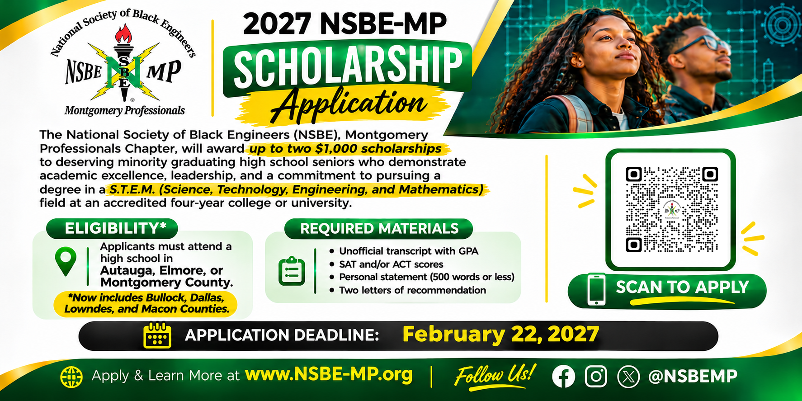

Each year, the National Society of Black Engineers Montgomery Professionals Chapter (NSBE-MP) awards
scholarships to 1 deserving high school senior with the intent of pursuing a technical or
engineering degree from an accredited four-year college or university. Students must be a resident of
Autauga, Elmore, or Montgomery Counties in Alabama and meet other stated requirements in order to qualify
for this award.

## 2027 Scholarship Application

**Applications must be submitted by February 27, 2027**

To apply for for the scholarship, [fill out the online application](https://forms.gle/D5aYWMiyKBTJTcwN7).

Information about how to submit your application, the amount, and other information can be found inside
of the application packet.
